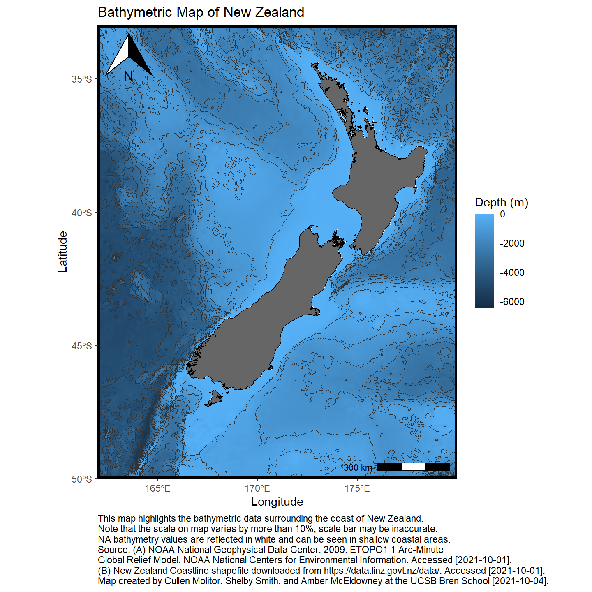

## Purpose

This notebook demonstrates how to work with geospatial data using the R software environment to make maps. I chose to plot the bathymetry around New Zealand. This project uses the R package `marmap` to querry NOAA databases to get the digital elevation model data. I then use a shapefile of the New Zealand coastlines to get better delineation between ocean and land.

### Load libraries

<details>
<summary>Show code</summary>


``` r
library(sf)
library(tidyverse)
library(raster)
library(here)
library(marmap)
library(ggspatial)
```


</details>

### Load Data

Use `marmap::getNOAA.bathy()` to load New Zealand bathymetry and elevation data directly from NOAA database and convert `bathy` object to `dataframe` for ggplot.

``` r
nz_df <- marmap::getNOAA.bathy(
  lon1 = 162,
  lon2 = 180,
  lat1 = -33,
  lat2 = -50,
  resolution = 1
) %>% 
  marmap::as.raster() %>% 
  raster::rasterToPoints() %>% 
  base::as.data.frame()%>%
              filter(layer <= 0)
```

Read in New Zealand coastlines with `sf::read_sf()` to read the shapefile containing the New Zealand coastline.

``` r
nz_coast <- sf::read_sf(
    "data/nz-coastlines-and-islands-polygons-topo-150k.shp"
  )
```

### Plot Data

Use `ggplot()` to plot New Zealand coastline, bathymetric raster, and depth contours.

``` r
ggplot() +
  geom_raster(data = nz_df,
              aes(x = x, y = y, fill = layer)) +
  geom_contour(data = nz_df,
               aes(x = x, y = y, z = layer), color = "grey20", size = .1) +
  geom_sf(data = nz_coast,  fill = "grey40", 
          color = "black", size = .15) +
  coord_sf(xlim = c(162, 180), ylim = c(-50, -33), expand = c(0, 0)) + 
  labs(fill = "Depth (m)",
       x = "Longitude",
       y = "Latitude",
       title = "Bathymetric Map of New Zealand",
       caption = 
"This map highlights the bathymetric data surrounding the coast of New Zealand.
Note that the scale on map varies by more than 10%, scale bar may be inaccurate.
NA bathymetry values are reflected in white and can be seen in shallow coastal areas.
Source: (A) NOAA National Geophysical Data Center. 2009: ETOPO1 1 Arc-Minute 
Global Relief Model. NOAA National Centers for Environmental Information. Accessed [2021-10-01]. 
(B) New Zealand Coastline shapefile downloaded from https://data.linz.govt.nz/data/. Accessed [2021-10-01].
Map created by Cullen Molitor, Shelby Smith, and Amber McEldowney at the UCSB Bren School [2021-10-04].") +
  ggspatial::annotation_scale(location = "br") +
  ggspatial::annotation_north_arrow(which_north=TRUE, location = "tl" ) +
  theme_classic()+
  theme(panel.border = element_rect(fill = NA, size = 2, color = "black"),
        plot.caption = element_text(hjust = 0))
```


