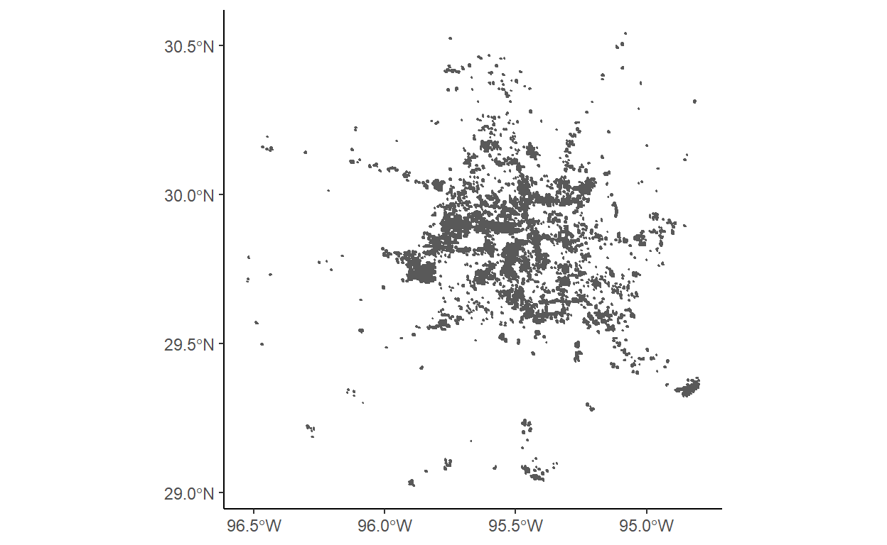
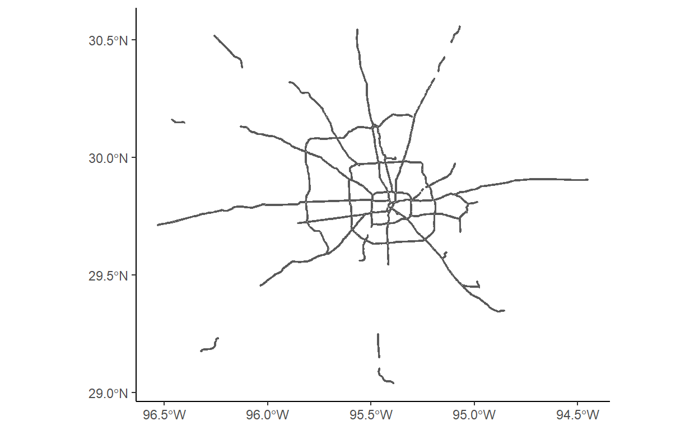
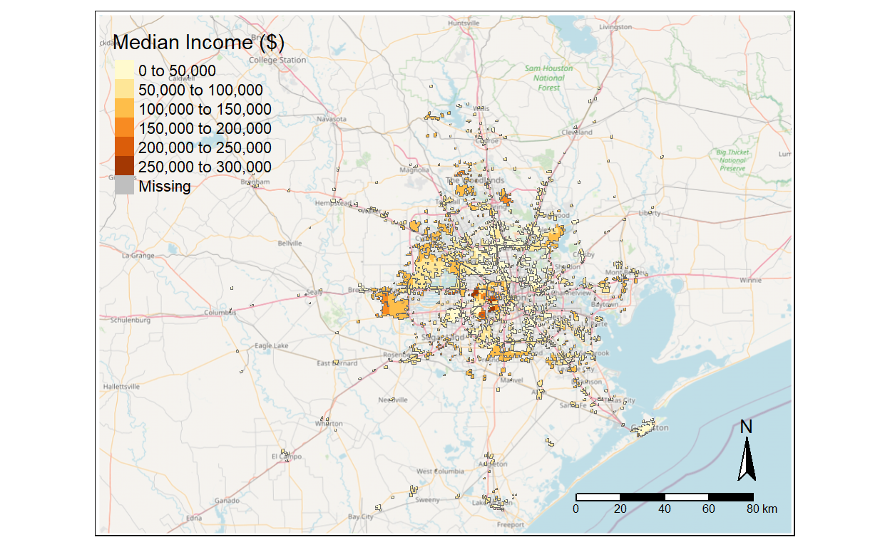
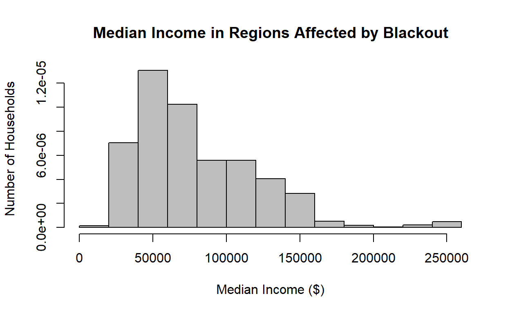
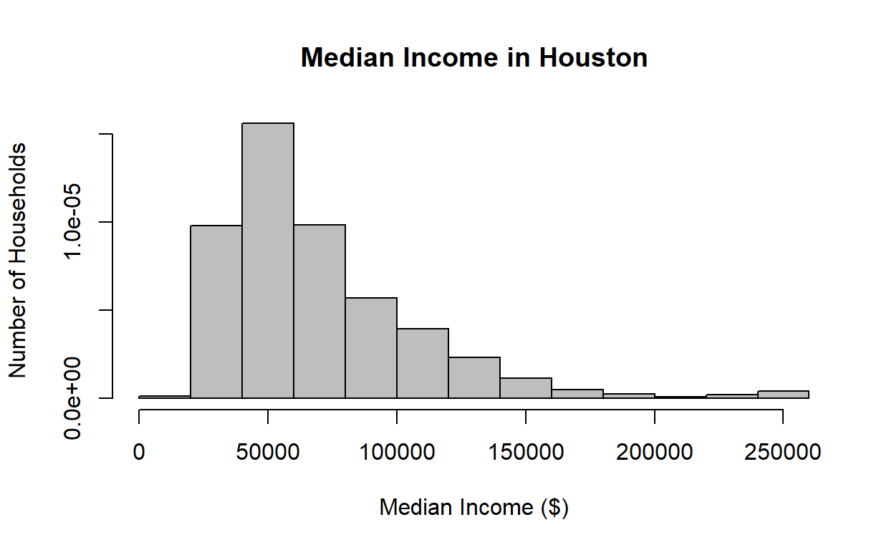

## Load libraries

<details>
<summary>Show code</summary>


``` r
library(sf)
library(tidyverse)
library(here)
library(stars)
library(rosm)
library(tmap)
```


</details>

## Function to load the DNB dataset from VNP46A1 granules

<details>
<summary>Show code</summary>


``` r
read_dnb <- function(file_name) {
  # Reads the "DNB_At_Sensor_Radiance_500m" dataset from a VNP46A1 granule into a STARS object.
  # Then read the sinolsoidal tile x/y positions and adjust the STARS dimensions (extent+delta)

  # The name of the dataset holding the nightlight band in the granule
  dataset_name <- "//HDFEOS/GRIDS/VNP_Grid_DNB/Data_Fields/DNB_At_Sensor_Radiance_500m"

  # From the metadata, we pull out a string containing the horizontal and vertical tile index
  h_string <- gdal_metadata(file_name)[199]
  v_string <- gdal_metadata(file_name)[219]
  
  # We parse the h/v string to pull out the integer number of h and v
  tile_h <- as.integer(str_split(h_string, "=", simplify = TRUE)[[2]])
  tile_v <- as.integer(str_split(v_string, "=", simplify = TRUE)[[2]])

  # From the h/v tile grid position, we get the offset and the extent
  west <- (10 * tile_h) - 180
  north <- 90 - (10 * tile_v)
  east <- west + 10
  south <- north - 10

  # A tile is 10 degrees and has 2400x2400 grid cells
  delta <- 10 / 2400

  # Reading the dataset
  dnb <- read_stars(file_name, sub = dataset_name)

  # Setting the CRS and applying offsets and deltas
  st_crs(dnb) <- st_crs(4326)
  st_dimensions(dnb)$x$delta <- delta
  st_dimensions(dnb)$x$offset <- west
  st_dimensions(dnb)$y$delta <- -delta
  st_dimensions(dnb)$y$offset <- north
  
  return(dnb)
}
```


</details>

## Read in day night band (DNB) data

<details>
<summary>Show code</summary>


``` r
Feb_07_v5 <- read_dnb(file_name = "data/VNP46A1.A2021038.h08v05.001.2021039064328.h5")
```


</details>

    //HDFEOS/GRIDS/VNP_Grid_DNB/Data_Fields/DNB_At_Sensor_Radiance_500m, 

<details>
<summary>Show code</summary>


``` r
Feb_07_v6 <- read_dnb(file_name = "data/VNP46A1.A2021038.h08v06.001.2021039064329.h5")
```


</details>

    //HDFEOS/GRIDS/VNP_Grid_DNB/Data_Fields/DNB_At_Sensor_Radiance_500m, 

<details>
<summary>Show code</summary>


``` r
Feb_16_v5 <- read_dnb(file_name = "data/VNP46A1.A2021047.h08v05.001.2021048091106.h5")
```


</details>

    //HDFEOS/GRIDS/VNP_Grid_DNB/Data_Fields/DNB_At_Sensor_Radiance_500m, 

<details>
<summary>Show code</summary>


``` r
Feb_16_v6 <- read_dnb(file_name = "data/VNP46A1.A2021047.h08v06.001.2021048091105.h5")
```


</details>

    //HDFEOS/GRIDS/VNP_Grid_DNB/Data_Fields/DNB_At_Sensor_Radiance_500m, 

## Combine adjacent tiles for each date

<details>
<summary>Show code</summary>


``` r
Feb_07_v5_v6 <- st_mosaic(Feb_07_v5, Feb_07_v6)
Feb_16_v5_v6 <- st_mosaic(Feb_16_v5, Feb_16_v6)
```


</details>

## Create blackout Mask

<details>
<summary>Show code</summary>


``` r
## Take the difference of light data from before the storm and after the storm to make a mask of values with a difference greater than 200 nW cm-2 sr-1
diff <- (Feb_07_v5_v6 - Feb_16_v5_v6) > 200

## Convert values with a difference of less than 200 to NA
diff[diff == F] <- NA
```


</details>

## Vectorize blackout mask

<details>
<summary>Show code</summary>


``` r
blackout_mask <- st_as_sf(diff)

## Fix invalid geometries 
blackout_mask_fixed <- st_make_valid(blackout_mask)

rm(diff, blackout_mask)
gc()
```


</details>

               used  (Mb) gc trigger   (Mb)  max used   (Mb)
    Ncells  3047944 162.8    4503170  240.5   4503170  240.5
    Vcells 27482570 209.7  132454492 1010.6 156217946 1191.9

## Crop the vectorized blackout mask to the region of interest

<details>
<summary>Show code</summary>


``` r
## Set region of interest
houston <- st_polygon(
  list(
    rbind(
      c(-96.5, 29), 
      c(-96.5, 30.5), 
      c(-94.5, 30.5), 
      c(-94.5, 29), 
      c(-96.5, 29)
    )
  )
) %>% 
  st_sfc(crs = 4326)

## Crop night lights data
intersects <- st_intersects(blackout_mask_fixed, houston, sparse = FALSE)
blackout_cropped <- blackout_mask_fixed[intersects,]

## Transform cropped blackout mask back to EPSG:3083 (NAD83 / Texas Centric Albers Equal Area)
blackout_cropped_NAD83 <- st_transform(blackout_cropped, 3083)

rm(blackout_cropped)
gc()
```


</details>

               used  (Mb) gc trigger  (Mb)  max used   (Mb)
    Ncells  3020703 161.4    4503170 240.5   4503170  240.5
    Vcells 27554636 210.3  105963594 808.5 156217946 1191.9

## Sanity check plot

<details>
<summary>Show code</summary>


``` r
ggplot() +
  geom_sf(data = blackout_cropped_NAD83) +
  theme_classic()
```


</details>



## Roads data

<details>
<summary>Show code</summary>


``` r
query <- 
  "SELECT * 
   FROM gis_osm_roads_free_1 
   WHERE fclass='motorway'"

highways <- 
  st_read(
    "data/gis_osm_roads_free_1.gpkg", 
    query = query) %>% 
  st_transform(crs = 3083) %>% 
  st_buffer(dist = 200) %>% 
  st_union()
```


</details>

    Reading query `SELECT * 
       FROM gis_osm_roads_free_1 
       WHERE fclass='motorway'' from data source `C:\Users\Cullen\OneDrive\Documents\MEDS\cullen-molitor.github.io\_posts\2021-12-03-houston-blackout-analysis-2021\data\gis_osm_roads_free_1.gpkg' 
      using driver `GPKG'
    Simple feature collection with 6085 features and 10 fields
    Geometry type: LINESTRING
    Dimension:     XY
    Bounding box:  xmin: -96.50429 ymin: 29.00174 xmax: -94.39619 ymax: 30.50886
    Geodetic CRS:  WGS 84

<details>
<summary>Show code</summary>


``` r
cat("\n\n\nAfter Transforming\n\n")
```


</details>


    After Transforming

<details>
<summary>Show code</summary>


``` r
highways
```


</details>

    Geometry set for 1 feature 
    Geometry type: MULTIPOLYGON
    Dimension:     XY
    Bounding box:  xmin: 1837420 ymin: 7218299 xmax: 2040621 ymax: 7387049
    Projected CRS: NAD83 / Texas Centric Albers Equal Area

## Basic highways plot

<details>
<summary>Show code</summary>


``` r
ggplot() +
  geom_sf(data = highways) +
  theme_classic()
```


</details>



## Buildings data

<details>
<summary>Show code</summary>


``` r
query <- 
  "SELECT * 
   FROM gis_osm_buildings_a_free_1
   WHERE (type IS NULL AND name IS NULL)
   OR type in ('residential', 'apartments', 'house', 'static_caravan', 'detached')"

buildings <- 
  st_read(
    "data/gis_osm_buildings_a_free_1.gpkg", 
    query = query) %>% 
  st_transform(crs = 3083) 
```


</details>

    Reading query `SELECT * 
       FROM gis_osm_buildings_a_free_1
       WHERE (type IS NULL AND name IS NULL)
       OR type in ('residential', 'apartments', 'house', 'static_caravan', 'detached')' from data source `C:\Users\Cullen\OneDrive\Documents\MEDS\cullen-molitor.github.io\_posts\2021-12-03-houston-blackout-analysis-2021\data\gis_osm_buildings_a_free_1.gpkg' 
      using driver `GPKG'
    Simple feature collection with 475941 features and 5 fields
    Geometry type: MULTIPOLYGON
    Dimension:     XY
    Bounding box:  xmin: -96.50055 ymin: 29.00344 xmax: -94.53285 ymax: 30.50393
    Geodetic CRS:  WGS 84

<details>
<summary>Show code</summary>


``` r
cat("\n\n\nAfter Transforming\n\n")
```


</details>


    After Transforming

<details>
<summary>Show code</summary>


``` r
buildings
```


</details>

    Simple feature collection with 475941 features and 5 fields
    Geometry type: MULTIPOLYGON
    Dimension:     XY
    Bounding box:  xmin: 1838180 ymin: 7216470 xmax: 2027040 ymax: 7386914
    Projected CRS: NAD83 / Texas Centric Albers Equal Area
    First 10 features:
         osm_id code   fclass name       type
    1  15289727 1500 building <NA>       <NA>
    2  15289869 1500 building <NA>       <NA>
    3  15299261 1500 building <NA> apartments
    4  15331425 1500 building <NA>       <NA>
    5  15349970 1500 building <NA>       <NA>
    6  20868178 1500 building <NA>       <NA>
    7  20871848 1500 building <NA>       <NA>
    8  20871948 1500 building <NA>       <NA>
    9  20876080 1500 building <NA>       <NA>
    10 20877241 1500 building <NA>       <NA>
                                 geom
    1  MULTIPOLYGON (((1948074 728...
    2  MULTIPOLYGON (((1927251 732...
    3  MULTIPOLYGON (((1984491 730...
    4  MULTIPOLYGON (((1932443 731...
    5  MULTIPOLYGON (((1925238 732...
    6  MULTIPOLYGON (((1922763 727...
    7  MULTIPOLYGON (((1922899 727...
    8  MULTIPOLYGON (((1922788 727...
    9  MULTIPOLYGON (((1922699 727...
    10 MULTIPOLYGON (((1922807 727...

## Census data

<details>
<summary>Show code</summary>


``` r
# st_layers("ACS_2019_5YR_TRACT_48_TEXAS.gdb"))

acs_geoms <- 
  st_read(
    "data/ACS_2019_5YR_TRACT_48_TEXAS.gdb",
    layer = "ACS_2019_5YR_TRACT_48_TEXAS"
  )
```


</details>

    Reading layer `ACS_2019_5YR_TRACT_48_TEXAS' from data source 
      `C:\Users\Cullen\OneDrive\Documents\MEDS\cullen-molitor.github.io\_posts\2021-12-03-houston-blackout-analysis-2021\data\ACS_2019_5YR_TRACT_48_TEXAS.gdb' 
      using driver `OpenFileGDB'
    Simple feature collection with 5265 features and 15 fields
    Geometry type: MULTIPOLYGON
    Dimension:     XY
    Bounding box:  xmin: -106.6456 ymin: 25.83716 xmax: -93.50804 ymax: 36.5007
    Geodetic CRS:  NAD83

<details>
<summary>Show code</summary>


``` r
acs_income <- 
  st_read(
    "data/ACS_2019_5YR_TRACT_48_TEXAS.gdb",
    layer = "X19_INCOME"
  ) %>% 
  select(GEOID, B19013e1) %>% 
  rename(GEOID_Data = GEOID,
         median_income = B19013e1)
```


</details>

    Reading layer `X19_INCOME' from data source 
      `C:\Users\Cullen\OneDrive\Documents\MEDS\cullen-molitor.github.io\_posts\2021-12-03-houston-blackout-analysis-2021\data\ACS_2019_5YR_TRACT_48_TEXAS.gdb' 
      using driver `OpenFileGDB'

<details>
<summary>Show code</summary>


``` r
acs_geoms_med <- left_join(acs_geoms, acs_income)  %>% 
  st_transform(crs = 3083) 
```


</details>

## Merge datasets

<details>
<summary>Show code</summary>


``` r
blackout_no_hwy <- st_difference(blackout_cropped_NAD83, highways)
rm(highways)
gc()
```


</details>

               used  (Mb) gc trigger   (Mb)  max used   (Mb)
    Ncells  7126649 380.7   20004878 1068.4  20004878 1068.4
    Vcells 56415877 430.5  105963594  808.5 156217946 1191.9

<details>
<summary>Show code</summary>


``` r
houston_res_wo_power <- buildings[blackout_no_hwy, op = st_intersects]
number_houses_wo_power <- length(houston_res_wo_power$osm_id)
```


</details>

## The number of buildings that were left without power is 157411.

<details>
<summary>Show code</summary>


``` r
acs_building <- st_join(houston_res_wo_power, acs_geoms_med, join = st_intersects)
```


</details>

<details>
<summary>Show code</summary>


``` r
acs_polygon <- st_join(blackout_no_hwy, acs_geoms_med, join = st_intersects)
```


</details>

<details>
<summary>Show code</summary>


``` r
houston_bbox <- st_bbox(houston)
houston_map <- osm.raster(houston_bbox)
```


</details>

## Area and Median Incomes of Residences Affected by Houston Blackout in February, 2021

<details>
<summary>Show code</summary>


``` r
tm_shape(houston_map) +
  tm_rgb(alpha = .75) +
  # tm_shape(acs_geoms_med,
  #          border.alpha = 0) +
  # tm_polygons(col = "median_income") +
  tm_shape(blackout_no_hwy) +
  tm_polygons(border.alpha = 1) +
  tm_shape(acs_polygon) + 
  tm_fill("median_income", 
          n = 5, 
          style = "pretty",
          title = "Median Income ($)") +
  tm_compass()+
  tm_scale_bar()
```


</details>



This map was created by Amber McEldowney and Cullen Molitor 2021-10-24.\
**Sources**: Socioeconomic data: U.S. Census Bureau's American Community Survey for Texas census tracts in 2019\
Light data: NASA's Level-1 and Atmosphere Archive & Distribution System Distributed Active Archive Center (LAADS DAAC)\
Spatial & Buildings Data: OpenStreetMap

<details>
<summary>Show code</summary>


``` r
rm(blackout_cropped_NAD83, acs_geoms, acs_income, buildings)
gc()
```


</details>

               used  (Mb) gc trigger   (Mb)  max used   (Mb)
    Ncells  4929805 263.3   16003903  854.8  20004878 1068.4
    Vcells 46664452 356.1  152763574 1165.5 156217946 1191.9

## Histogram of Median Income for Houses Affected by Blackout

<details>
<summary>Show code</summary>


``` r
Median_Income <- acs_polygon$median_income
hist(Median_Income,
main="Median Income in Regions Affected by Blackout",
xlab="Median Income ($)",
ylab="Number of Households",
col="grey",
freq=FALSE
)
```


</details>



## Histogram of Median Income in Houston

<details>
<summary>Show code</summary>


``` r
houston_nad <- houston %>%
  st_as_sf() %>%
  st_transform(houston, crs = 3083)

# acs_geoms_med_bb <- st_join(acs_geoms_med, houston_nad, join = st_intersects)

intersects <- st_intersects(acs_geoms_med, houston_nad, sparse = FALSE)
acs_geoms_med_bb <- acs_geoms_med[intersects,]

Median_Income_Houston <- acs_geoms_med_bb$median_income
hist(Median_Income_Houston,
main="Median Income in Houston",
xlab="Median Income ($)",
ylab="Number of Households",
col="grey",
freq=FALSE
)
```


</details>



We thought it would be interesting to compare the median incomes of households affected by the blackout, to median incomes in Houston in general, but because the blackouts seem to have occured in a more metropolitan area, it is likely the incomes are skewed higher for that area, and it does not give a clear indication of whether median income had an effect on whether or not a household experienced a blackout.
