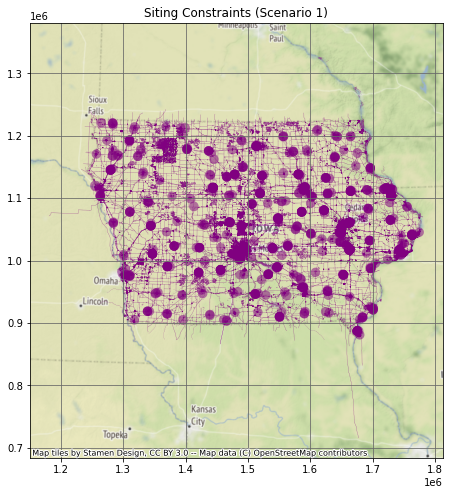
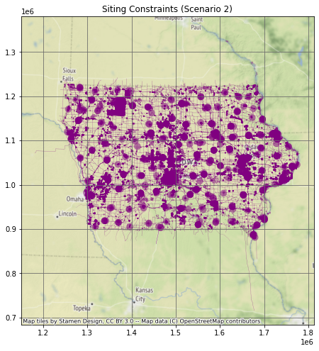
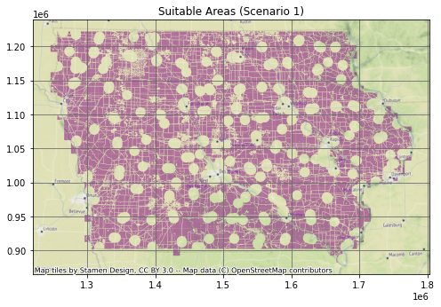
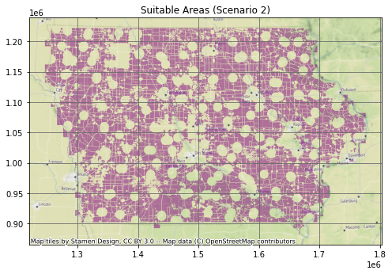

## Import Modules

<details>
<summary>Show code</summary>

``` python
import sqlalchemy as sa
import geopandas as gpd
import pandas as pd
import matplotlib.pyplot as plt
import contextily as ctx
import math
%matplotlib inline
```

</details>

## Database Connection

<details>
<summary>Show code</summary>

``` python
pg_uri_template = 'postgresql+psycopg2://{user}:{pwd}@{host}/{db_name}'
db_uri = pg_uri_template.format(
    drivername='postgresql+psycopg2',
    host = '{ip address}',
    user = '{username}',
    pwd = '{pwd}',
    db_name = 'osmiowa'
)
engine = sa.create_engine(db_uri)
```

</details>

## Data Details

Database Name: - osmiowa

Database Tables: - planet_osm_line - planet_osm_point - planet_osm_polygon - planet_osm_roads - spatial_ref_sys - wind - wind_cells

Geometry: - Projected in [EPSG:26975](https://epsg.io/26975) - Geodetic CRS: NAD83 - Units: meters - Coordinate system: Cartesian 2D CS - Axes: easting, northing (X,Y) - Orientations: east, north

# Query Database

Residential Scenario 1 (3H)

<details>
<summary>Show code</summary>

``` python
sql_buildings_residential_1 = \
"""
SELECT 
    ST_BUFFER(way, 450) as way
FROM 
    planet_osm_polygon 
WHERE 
    building IN ('yes', 'residential', 'apartments', 'house', 'static_caravan', 'detached')
OR 
    landuse = 'residential'
OR 
    place = 'town'
"""
```

</details>

Residential Scenario 2 (10H)

<details>
<summary>Show code</summary>

``` python
sql_buildings_residential_2 = \
"""
SELECT 
    ST_BUFFER(way, 1500) as way 
FROM 
    planet_osm_polygon 
WHERE 
    building 
IN 
    ('yes', 'residential', 'apartments', 'house', 'static_caravan', 'detached')
OR 
    landuse = 'residential'
OR
    place = 'town'
"""
```

</details>

Non-residential (3H)

<details>
<summary>Show code</summary>

``` python
sql_buildings_nonresidential = \
"""
SELECT 
    ST_BUFFER(way, 450) as way
FROM 
    planet_osm_polygon 
WHERE 
    building 
NOT IN 
    ('yes', 'residential', 'apartments', 'house', 'static_caravan', 'detached')
"""
```

</details>

Airports

<details>
<summary>Show code</summary>

``` python
sql_airports = \
"""
SELECT 
    ST_BUFFER(way, 7500) as way
FROM 
    planet_osm_polygon 
WHERE 
    aeroway IS NOT NULL
"""
```

</details>

Military Bases

<details>
<summary>Show code</summary>

``` python
sql_military = \
"""
SELECT 
    ST_BUFFER(way, 0) as way 
FROM 
    planet_osm_polygon 
WHERE 
    military IS NOT NULL
OR 
    landuse = 'military'
"""
```

</details>

Railways and Roads

<details>
<summary>Show code</summary>

``` python
sql_railways_n_roads = \
"""
SELECT 
    ST_BUFFER(way, 300) as way
FROM 
    planet_osm_line 
WHERE 
    (railway IS NOT NULL
     AND railway 
     NOT IN ('abandoned', 'disused', 'razed', 'dismantled'))
OR 
    (highway IS NOT NULL
AND 
    highway 
IN 
    ('motorway', 'motorway_link', 'trunk', 'trunk_link', 'road',
    'primary', 'primary_link', 'secondary', 'secondary_link'))
"""
```

</details>

Nature Reserves, Parks, and Wetlands

<details>
<summary>Show code</summary>

``` python
sql_nature = \
"""
SELECT 
    way 
FROM 
    planet_osm_polygon 
WHERE 
    leisure 
IN 
    ('nature_reserve', 'park')
OR
    "natural" 
IN 
    ('wetland')
"""
```

</details>

Rivers

<details>
<summary>Show code</summary>

``` python
sql_rivers = \
"""
SELECT 
    ST_BUFFER(way, 150) as way 
FROM 
    planet_osm_line 
WHERE 
    waterway 
IN 
    ('river')
"""
```

</details>

Lakes

<details>
<summary>Show code</summary>

``` python
sql_lakes = \
"""
SELECT
    way
FROM 
    planet_osm_polygon
WHERE 
    water 
IN 
    ('lake', 'reservoir', 'pond')
"""
```

</details>

Power Lines

<details>
<summary>Show code</summary>

``` python
sql_powerlines = \
"""
SELECT 
    ST_BUFFER(way, 300) as way
FROM 
    planet_osm_line 
WHERE 
    power IS NOT NULL
"""
```

</details>

Power Plants

<details>
<summary>Show code</summary>

``` python
sql_powerplants = \
"""
SELECT 
    ST_BUFFER(way, 150) as way
FROM 
    planet_osm_polygon 
WHERE 
    power IS NOT NULL
"""
```

</details>

Wind Turbines

<details>
<summary>Show code</summary>

``` python
sql_turbines = \
"""
SELECT
    ST_BUFFER(way, 680) as way
FROM 
    planet_osm_point 
WHERE 
    "generator:source" IS NOT NULL
AND 
    "generator:source" IN ('wind')
"""
```

</details>

## Merge Subqueries

### Scenario 1

<details>
<summary>Show code</summary>

``` python
sql_siting_constraints = \
f"""
{sql_buildings_residential_1} 
UNION
{sql_buildings_nonresidential} 
UNION
{sql_airports} 
UNION
{sql_military} 
UNION
{sql_railways_n_roads} 
UNION
{sql_nature} 
UNION
{sql_rivers} 
UNION
{sql_lakes} 
UNION
{sql_powerlines}
UNION
{sql_powerplants}
UNION
{sql_turbines}
"""
siting_constraints = gpd.read_postgis(sql_siting_constraints, con = engine, geom_col = 'way')
```

</details>

### Scenario 2

<details>
<summary>Show code</summary>

``` python
sql_siting_constraints_2 = \
f"""
{sql_buildings_residential_2} 
UNION
{sql_buildings_nonresidential} 
UNION
{sql_airports} 
UNION
{sql_military} 
UNION
{sql_railways_n_roads} 
UNION
{sql_nature} 
UNION
{sql_rivers} 
UNION
{sql_lakes} 
UNION
{sql_powerlines}
UNION
{sql_powerplants}
UNION
{sql_turbines}
"""
siting_constraints_2 = gpd.read_postgis(sql_siting_constraints_2, con = engine, geom_col = 'way')
```

</details>

<details>
<summary>Show code</summary>

``` python
fig, ax = plt.subplots(figsize=(8, 8))
siting_constraints.plot(ax = ax, markersize = .1, color = "purple", alpha = .5)
ax.grid(True, color = 'dimgray')
ax.set_title('Siting Constraints (Scenario 1)', fontsize=12)
ax.ticklabel_format(scilimits =  [-5, 5])
ctx.add_basemap(ax, crs="EPSG:26975")
```

</details>



<details>
<summary>Show code</summary>

``` python
fig, ax = plt.subplots(figsize=(8, 8))
siting_constraints_2.plot(ax = ax, markersize = .1, color = "purple", alpha = .5)
ax.grid(True, color = 'dimgray')
ax.set_title('Siting Constraints (Scenario 2)', fontsize=12)
ax.ticklabel_format(scilimits =  [-5, 5])
ctx.add_basemap(ax, crs="EPSG:26975")
```

</details>



## Wind Data

The table wind_cells_10000 contains 10 km2 square polygons with associated average annual wind speeds (m s-1), arranged to cover Iowa in a ragged grid.

<details>
<summary>Show code</summary>

``` python
sql_wind_speeds = \
"""
SELECT * 
FROM 
    wind_cells_10000 
WHERE 
    wind_speed IS NOT NULL
"""
wind_speeds = gpd.read_postgis(sql_wind_speeds, con = engine, geom_col = 'geom')
```

</details>

# Results

## Scenario #1

### Subtract Siting Constraints from Wind Cells

<details>
<summary>Show code</summary>

``` python
suitable_cells = wind_speeds.overlay(siting_constraints, how = 'difference', keep_geom_type = False)
```

</details>

### Plot Suitable Wind Cells

<details>
<summary>Show code</summary>

``` python
fig, ax = plt.subplots(figsize=(8, 8))
suitable_cells.plot(ax = ax, markersize = .1, color = "purple", alpha = .5)
ax.grid(True, color = 'dimgray')
ax.set_title('Suitable Areas (Scenario 1)', fontsize=12)
ax.ticklabel_format(scilimits =  [-5, 5])
ctx.add_basemap(ax, crs="EPSG:26975")
```

</details>



### Find Number of Turbines

<details>
<summary>Show code</summary>

``` python
rotor_5x = math.pi * (136 * 5) ** 2
suitable_cells["area"] = suitable_cells['geom'].area
suitable_cells["number_wind_turbines"] = suitable_cells['geom'].area / rotor_5x
```

</details>

<details>
<summary>Show code</summary>

``` python
total_wind_turbines = suitable_cells["number_wind_turbines"].sum()
print("The total number of turbines in scenario 1 is:", round(total_wind_turbines))
```

</details>

    The total number of turbines in scenario 1 is: 57286

### Power production

<details>
<summary>Show code</summary>

``` python
suitable_cells['energy_per_turbine'] = 2.6 * suitable_cells['wind_speed'] - 5
suitable_cells['power_per_cell'] = suitable_cells['energy_per_turbine'] * suitable_cells['number_wind_turbines']
```

</details>

### Total Power Production

<details>
<summary>Show code</summary>

``` python
total_scenario_1 = suitable_cells['power_per_cell'].sum()
print("The total power produced in scenario 1 is:", round(total_scenario_1), "GWH/year")
```

</details>

    The total power produced in scenario 1 is: 1064159 GWH/year

## Scenario #2

### Subtract Siting Constraints from Wind Cells

<details>
<summary>Show code</summary>

``` python
suitable_cells_2 = wind_speeds.overlay(siting_constraints_2, how = 'difference', keep_geom_type = False)
```

</details>

### Plot Suitable Wind Cells

<details>
<summary>Show code</summary>

``` python
fig, ax = plt.subplots(figsize=(8, 8))
suitable_cells_2.plot(ax = ax, markersize = .1, color = "purple", alpha = .5)
ax.grid(True, color = 'dimgray')
ax.set_title('Suitable Areas (Scenario 2)', fontsize=12)
ax.ticklabel_format(scilimits =  [-5, 5])
ctx.add_basemap(ax, crs="EPSG:26975")
```

</details>



### Find Number of Turbines

<details>
<summary>Show code</summary>

``` python
rotor_5x = math.pi * (136 * 5) ** 2
suitable_cells_2["area"] = suitable_cells_2['geom'].area
suitable_cells_2["number_wind_turbines"] = suitable_cells_2['geom'].area / rotor_5x
```

</details>

<details>
<summary>Show code</summary>

``` python
total_wind_turbines_2 = suitable_cells_2["number_wind_turbines"].sum()
print("The total number of turbines in scenario 2 is:", round(total_wind_turbines_2))
```

</details>

    The total number of turbines in scenario 2 is: 52055

### Power Production

<details>
<summary>Show code</summary>

``` python
suitable_cells_2['energy_per_turbine'] = 2.6 * suitable_cells_2['wind_speed'] - 5
suitable_cells_2['power_per_cell'] = suitable_cells_2['energy_per_turbine'] * suitable_cells_2['number_wind_turbines']
wind_speeds
```

</details>

         id     geom                                                wind_speed
  ------ ------ --------------------------------------------------- ------------
  0      1      POLYGON ((1256222.769 1212179.582, 1266222.769...   9.336039
  1      2      POLYGON ((1266222.769 1212179.582, 1276222.769...   9.097315
  2      3      POLYGON ((1276222.769 1212179.582, 1286222.769...   8.984566
  3      4      POLYGON ((1286222.769 1212179.582, 1296222.769...   9.266137
  4      5      POLYGON ((1296222.769 1212179.582, 1306222.769...   9.296747
  ...    ...    ...                                                 ...
  1437   1438   POLYGON ((1686222.769 902179.582, 1696222.769 ...   8.678687
  1438   1439   POLYGON ((1426222.769 892179.582, 1436222.769 ...   9.114730
  1439   1440   POLYGON ((1656222.769 892179.582, 1666222.769 ...   8.237385
  1440   1441   POLYGON ((1666222.769 892179.582, 1676222.769 ...   8.423034
  1441   1442   POLYGON ((1666222.769 882179.582, 1676222.769 ...   8.109468

1442 rows × 3 columns

### Total Power Production

<details>
<summary>Show code</summary>

``` python
total_scenario_2 = suitable_cells_2['power_per_cell'].sum()
print("The total power produced in scenario 2 is:", round(total_scenario_2), " GWH/year")
```

</details>

    The total power produced in scenario 2 is: 967009  GWH/year
