## Setup

Import Modules

``` python
import geopandas as gpd 
import rasterio as rio
from rasterio.plot import show
import numpy as np
import pandas as pd
import matplotlib.image as mpimg
import matplotlib.pyplot as plt
import os
import glob
import contextily as ctx
import shapely
from shapely.geometry import Polygon
%matplotlib inline
```

Set Parameters and constants

``` python
shoreline_shapefile  = 'data/dominica/dma_admn_adm0_py_s1_dominode_v2.shp'
whales_CSV           = 'data/sightings2005_2018.csv'
vessels_CSV          = 'data/station1249.csv'
ten_kn_in_ms = 5.14
projected_EPSG = 2002   # Dominica 1945 / British West Indies Grid
geodetic_EPSG  = 4326   # WGS 84 (use as default CRS for incoming latlon)
```

## Load Data

Dominica Shape File

``` python
dominica_shp = gpd.read_file(shoreline_shapefile)
dominica_shp.head()
```

      ADM0_PCODE   ADM0_EN    geometry
  --- ------------ ---------- ---------------------------------------------------
  0   DM           Dominica   POLYGON ((-61.43023 15.63952, -61.43019 15.639...

Set CRS to [EPSG 2002](https://epsg.io/2002)

``` python
dominica_shp = dominica_shp.to_crs(projected_EPSG)
dominica_shp.crs
```

    <Projected CRS: EPSG:2002>
    Name: Dominica 1945 / British West Indies Grid
    Axis Info [cartesian]:
    - E[east]: Easting (metre)
    - N[north]: Northing (metre)
    Area of Use:
    - name: Dominica - onshore.
    - bounds: (-61.55, 15.14, -61.2, 15.69)
    Coordinate Operation:
    - name: British West Indies Grid
    - method: Transverse Mercator
    Datum: Dominica 1945
    - Ellipsoid: Clarke 1880 (RGS)
    - Prime Meridian: Greenwich

## Plot Dominica

``` python
fig, ax = plt.subplots(figsize=(5, 5))
ax.grid(True, color = 'dimgray')
ax.set(ylim=(1.67e6,1.74e6), xlim=(445000, 490000))
ax.ticklabel_format(scilimits =  [-5, 5])
dominica_shp.plot(ax = ax, edgecolor = "k", facecolor="None")
ctx.add_basemap(ax, crs=projected_EPSG)
```

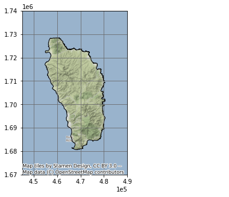

## Load Data

Whale Sightings

``` python
whales = gpd.read_file(whales_CSV)
whales
```

         field_1   GPStime               Lat           Long           geometry
  ------ --------- --------------------- ------------- -------------- ----------
  0      0         2005-01-15 07:43:27   15.36977117   -61.49328433   None
  1      1         2005-01-15 08:07:13   15.3834075    -61.503702     None
  2      2         2005-01-15 08:31:17   15.38106333   -61.50486067   None
  3      3         2005-01-15 09:19:10   15.33532083   -61.46858117   None
  4      4         2005-01-15 10:08:00   15.294224     -61.45318517   None
  ...    ...       ...                   ...           ...            ...
  4888   4888      2018-05-25 12:01:25   15.39195      -61.572        None
  4889   4889      2018-05-25 13:08:29   15.4189       -61.5833       None
  4890   4890      2018-05-25 14:50:00   15.443483     -61.60995      None
  4891   4891      2018-05-25 15:57:34   15.499866     -61.638333     None
  4892   4892      2018-05-25 16:17:10   15.494783     -61.6482       None

4893 rows × 5 columns

Create GeoDataFrame

``` python
points = gpd.points_from_xy(whales['Long'], whales['Lat'], crs = geodetic_EPSG)
whales_gdf = gpd.GeoDataFrame(whales, geometry = points)
whales_gdf = whales_gdf.to_crs(projected_EPSG)
```

Plot Whale Sightings

``` python
fig, ax = plt.subplots(figsize = (10, 10))
ax.set_aspect('equal')
ax.grid(True, color = 'dimgray')
ax.set(xlim=(4e5, 5e5), ylim=(1.5e6, 1.8e6))
dominica_shp.plot(ax = ax, color='None', edgecolor = "k")
whales_gdf.plot(ax = ax, markersize = .1, color = "purple", alpha = .25)
ax.set_title('Whale Sightings', fontsize=12)
ax.ticklabel_format(scilimits =  [-5, 5])
ctx.add_basemap(ax, crs = projected_EPSG)
```

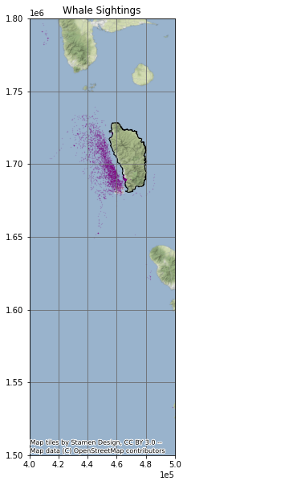

## Create Grid

``` python
xmin, ymin, xmax, ymax = whales_gdf.total_bounds
cell_size = 2000
xs = list(np.arange(xmin, xmax + cell_size, cell_size))
ys = list(np.arange(ymin, ymax + cell_size, cell_size))
def make_cell(x, y, cell_size):
    ring = [
        (x, y),
        (x + cell_size, y),
        (x + cell_size, y + cell_size),
        (x, y + cell_size)
    ]
    cell = shapely.geometry.Polygon(ring)
    return cell
cells = []
for x in xs:
    for y in ys:
        cell = make_cell(x, y, cell_size)
        cells.append(cell)
grid = gpd.GeoDataFrame({'geometry': cells}, crs = geodetic_EPSG)
grid = grid.set_geometry(crs = projected_EPSG, col = grid['geometry'])
```

Plot Grid

``` python
grid.plot(facecolor = "none", figsize = (10, 10), linewidth = 1)
```

    <AxesSubplot:>

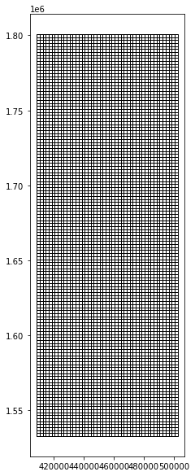

Extract Whale Habitat

``` python
whale_grid = grid.sjoin(whales_gdf, how="inner")
```

Plot whale sighting grid cells

``` python
whale_grid.plot(facecolor = "none", figsize = (10, 10), linewidth = .75)
```

    <AxesSubplot:>

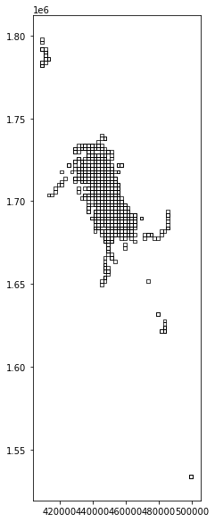

### Summarise Whale Counts

``` python
grid['count'] = whale_grid.groupby(whale_grid.index).count()['index_right']
grid = grid[grid['count'] > 20]
```

Plot Whale Habitat

``` python
grid.plot(facecolor = "none", figsize = (10, 10), linewidth = .75)
```

    <AxesSubplot:>

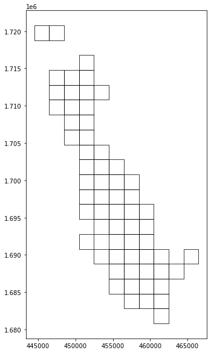

### Create Unary Union

``` python
grid_union = grid.unary_union
grid_union
```

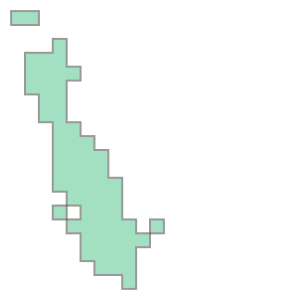

## Create Vessel Speed Reduction Zone

The vessel speed reduction zone is determined by the whale habitat areas in which more than 20 whales were observed per 2,000 m².

``` python
grid_convex = grid_union.convex_hull
grid_convex
```

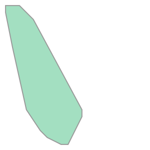

Make GeoDataFrame

``` python
whale_habitat = gpd.GeoDataFrame(index = [0], geometry = [grid_convex], crs = projected_EPSG)
```

Plot

``` python
fig, ax = plt.subplots(figsize = (10, 10))
ax.grid(True, color = 'dimgray')
ax.set(xlim=(4.4e5, 4.85e5), ylim=(1.675e6, 1.73e6))
dominica_shp.plot(ax = ax, color='None', edgecolor = "k")
whale_habitat.plot(ax = ax, edgecolor = "purple", facecolor = 'none')
ax.set_title('Whale Habitat', fontsize=12)
ax.ticklabel_format(scilimits =  [-5, 5])
ctx.add_basemap(ax, crs = projected_EPSG)
```

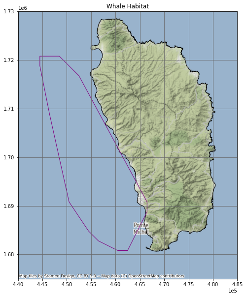

``` python
whale_habitat_diff = whale_habitat.difference(dominica_shp)
whale_habitat = gpd.GeoDataFrame(geometry = whale_habitat_diff)
whale_habitat
```

      geometry
  --- ---------------------------------------------------
  0   POLYGON ((456480.652 1682792.746, 454480.652 1...

``` python
fig, ax = plt.subplots(figsize = (10, 10))
ax.grid(True, color = 'dimgray')
ax.set(xlim=(4.4e5, 4.85e5), ylim=(1.675e6, 1.73e6))
dominica_shp.plot(ax = ax, color='None', edgecolor = "k")
whale_habitat.plot(ax = ax, edgecolor = "purple", facecolor = 'none')
ax.set_title('Whale Habitat', fontsize=12)
ax.ticklabel_format(scilimits =  [-5, 5])
ctx.add_basemap(ax, crs = projected_EPSG)
```

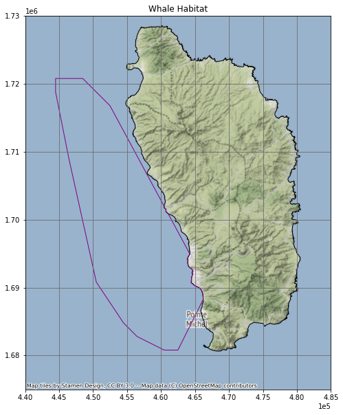

``` python
whale_habitat
```

      geometry
  --- ---------------------------------------------------
  0   POLYGON ((456480.652 1682792.746, 454480.652 1...

## Load AIS Vessel Data

``` python
vessels = gpd.read_file(vessels_CSV)
points = gpd.points_from_xy(vessels['LON'], vessels['LAT'], crs = geodetic_EPSG)
vessels_gdf = gpd.GeoDataFrame(vessels, geometry = points)
vessels_gdf = vessels_gdf.to_crs(projected_EPSG)
vessels_gdf['TIMESTAMP'] = pd.to_datetime(vessels_gdf['TIMESTAMP'])
vessels_gdf
```

           field_1   MMSI        LON         LAT        TIMESTAMP             geometry
  -------- --------- ----------- ----------- ---------- --------------------- ----------------------------
  0        0         233092000   -61.84788   15.23238   2015-05-22 13:53:26   POINT (-61.84788 15.23238)
  1        1         255803280   -61.74397   15.96114   2015-05-22 13:52:57   POINT (-61.74397 15.96114)
  2        2         329002300   -61.38968   15.29744   2015-05-22 13:52:32   POINT (-61.38968 15.29744)
  3        3         257674000   -61.54395   16.2334    2015-05-22 13:52:24   POINT (-61.54395 16.23340)
  4        4         636092006   -61.52401   15.81954   2015-05-22 13:51:23   POINT (-61.52401 15.81954)
  ...      ...       ...         ...         ...        ...                   ...
  617257   238722    256525000   -61.40679   15.36907   2015-05-21 21:34:59   POINT (-61.40679 15.36907)
  617258   238723    311077100   -61.37539   15.27406   2015-05-21 21:34:55   POINT (-61.37539 15.27406)
  617259   238724    377907247   -61.39461   15.30672   2015-05-21 21:34:46   POINT (-61.39461 15.30672)
  617260   238725    253365000   -61.49001   16.14007   2015-05-21 21:34:46   POINT (-61.49001 16.14007)
  617261   238726    329002300   -61.48073   15.44751   2015-05-21 21:34:45   POINT (-61.48073 15.44751)

617262 rows × 6 columns

### Select Vessels Inside Whale Habitat

``` python
vessels_whale = vessels_gdf.sjoin(whale_habitat, how = 'inner')
vessels_whale
```

           field_1   MMSI        LON         LAT        TIMESTAMP             geometry                         index_right
  -------- --------- ----------- ----------- ---------- --------------------- -------------------------------- -------------
  2        2         329002300   -61.38968   15.29744   2015-05-22 13:52:32   POINT (464555.392 1690588.725)   0
  7        7         338143127   -61.39575   15.33418   2015-05-22 13:50:54   POINT (463892.452 1694650.397)   0
  13       13        329002300   -61.38968   15.29745   2015-05-22 13:48:32   POINT (464555.389 1690589.831)   0
  15       15        338143015   -61.39558   15.33423   2015-05-22 13:47:31   POINT (463910.683 1694655.978)   0
  16       16        338143127   -61.39757   15.33139   2015-05-22 13:47:25   POINT (463697.964 1694341.275)   0
  ...      ...       ...         ...         ...        ...                   ...                              ...
  617252   238717    329002300   -61.4885    15.4706    2015-05-21 21:37:45   POINT (453901.647 1709712.916)   0
  617253   238718    338143015   -61.39553   15.33448   2015-05-21 21:37:14   POINT (463915.972 1694683.643)   0
  617255   238720    338143127   -61.39563   15.33468   2015-05-21 21:35:12   POINT (463905.177 1694705.734)   0
  617259   238724    377907247   -61.39461   15.30672   2015-05-21 21:34:46   POINT (464023.288 1691613.624)   0
  617261   238726    329002300   -61.48073   15.44751   2015-05-21 21:34:45   POINT (454741.236 1707161.130)   0

167402 rows × 7 columns

### Plot Vessel Data

``` python
fig, ax = plt.subplots(figsize = (10, 10))
ax.grid(True, color = 'dimgray')
ax.set(xlim=(4.4e5, 4.85e5), ylim=(1.675e6, 1.73e6))
dominica_shp.plot(ax = ax, color='None', edgecolor = "k")
vessels_whale.plot(ax = ax, markersize = .1, color = "purple", alpha = .1)
ax.set_title('Vessel Data Inside Whale Habitat', fontsize=12)
ax.ticklabel_format(scilimits =  [-5, 5])
ctx.add_basemap(ax, crs = projected_EPSG)
```

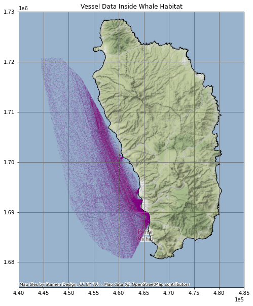

## Calculate Vessel Speeds

``` python
vessels_whale_sorted = vessels_whale.sort_values(['MMSI', 'TIMESTAMP'])
vessels_whale_shifted = vessels_whale_sorted.shift(periods = 1)
vw_sorted_shifted = vessels_whale_sorted.join(vessels_whale_shifted, lsuffix = "_original", rsuffix = "_copy")
vw_matched = vw_sorted_shifted[vw_sorted_shifted['MMSI_original'] == vw_sorted_shifted['MMSI_copy']]
vw_matched = vw_matched.set_geometry(col = vw_matched['geometry_original'], crs = projected_EPSG)
vw_matched['distance_m'] = vw_matched['geometry_original'].distance(vw_matched['geometry_copy']) 
vw_matched['time_s'] = vw_matched['TIMESTAMP_original'] - vw_matched['TIMESTAMP_copy']
vw_matched['time_s'] = vw_matched['time_s'].dt.total_seconds() 
vw_matched['speed_ms'] = vw_matched['distance_m'] / vw_matched['time_s']
vw_matched['10_kn_time'] = vw_matched['distance_m'] / ten_kn_in_ms
vw_matched['time_diff'] = vw_matched['10_kn_time'].sub(vw_matched['time_s'])
vw_matched = vw_matched[vw_matched['time_diff'] > 0]
```

### Plot Vessels travelling over 10 knots

``` python
fig, ax = plt.subplots(figsize = (10, 10))
ax.grid(True, color = 'dimgray')
ax.set(xlim=(4.4e5, 4.85e5), ylim=(1.675e6, 1.73e6))
dominica_shp.plot(ax = ax, color='None', edgecolor = "k")
vw_matched.plot(ax = ax, markersize = .1, color = "purple", alpha = .25)
ax.set_title('Vessel Data Inside Whale Habitat', fontsize=12)
ax.ticklabel_format(scilimits =  [-5, 5])
ctx.add_basemap(ax, crs = projected_EPSG)
```

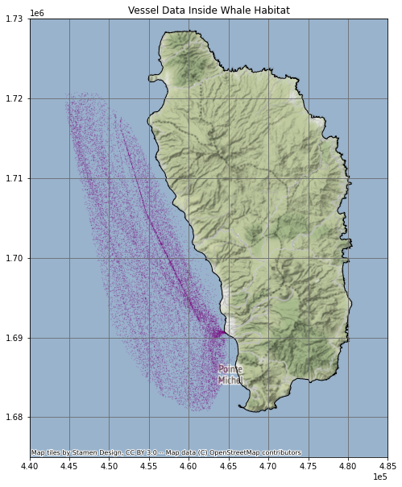

## Impact of a 10 knot Speed Reduction Zone

We calculated that ship vessel traffic would be slowed by 2 minutes per mile on average. Over the course of the year, this equated to approximately 28 days of increased shipping time.

``` python
num_days = vw_matched['time_diff'].sum() / 60 / 60 /24
```

``` python
num_days
```

    27.9423247732646

``` python
mean_time_lost = vw_matched['time_diff'].mean() / 60
```

``` python
mean_time_lost
```

    1.8906563139508044

``` {.r .distill-force-highlighting-css}
```
