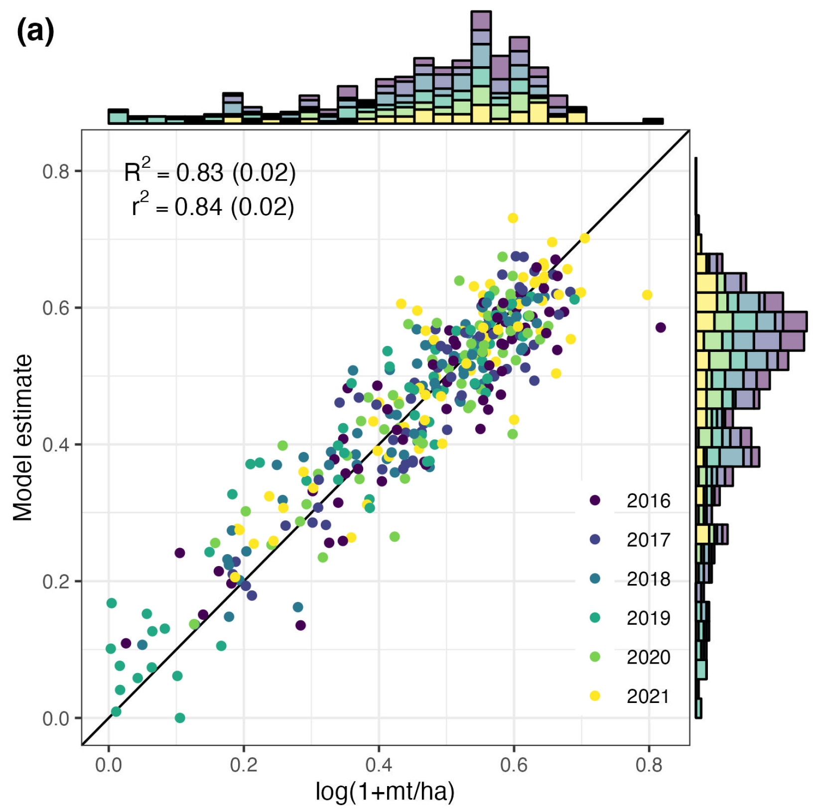

Our paper, [Monitoring Maize Yield Variability over Space and Time with Unsupervised Satellite Imagery Features](https://doi.org/10.3390/rs17213641), is now out in *Remote Sensing*. It started as our [MEDS capstone project](../2022-05-29-publicpresentation/) and grew into a full paper with Juliet Cohen, Grace Lewin, Steven Cognac, Protensia Hadunka, Jonathan Proctor, and Tamma Carleton.

## The question

Zambia is prone to severe droughts and crop failures, but ground data on yields is limited. During COVID-19, for example, district-level maize surveys stopped entirely. Methods like [MOSAIKS](https://center-for-effective-global-action-cega.github.io/MOSAIKS-Training-Manual/en/index.html) make it cheap to turn satellite imagery into features for prediction. Until now, though, nobody had tested whether these simple pipelines can track change **over time** in a low-data, developing-country setting. Most evaluations only look at variation across space.

## What we did

We computed random convolutional features from Landsat and Sentinel-2 imagery and paired them with district-level yield data. We then fit plain linear ridge regression models. There is no deep learning and no task-specific architecture.

## What we found

{fig-alt="Scatter plot of model-estimated versus observed log maize yields for Zambian districts from 2016 to 2021, colored by year, with marginal histograms. Points cluster along the 1:1 line; R squared is 0.83."}

- The model explains **83%** of out-of-sample maize yield variation from 2016 to 2021. That is slightly better than a model built on NDVI features, the standard approach practitioners use to monitor crop health.
- The real difference shows up over **time**. When predicting year-to-year variation alone, our model keeps an R² of **0.74**, while the NDVI model drops to **0.39**.

## Why it matters

Monitoring droughts and food security depends on catching change from year to year. Our results show that task-agnostic featurization can capture that change even where ground truth is sparse and compute is limited. Imagery-based monitoring can work in exactly the places where expensive approaches are out of reach.

**Citation:** Molitor, C., Cohen, J., Lewin, G., Cognac, S., Hadunka, P., Proctor, J., Carleton, T. (2025). Monitoring Maize Yield Variability over Space and Time with Unsupervised Satellite Imagery Features. *Remote Sensing*, 17(21), 3641. [doi:10.3390/rs17213641](https://doi.org/10.3390/rs17213641)
