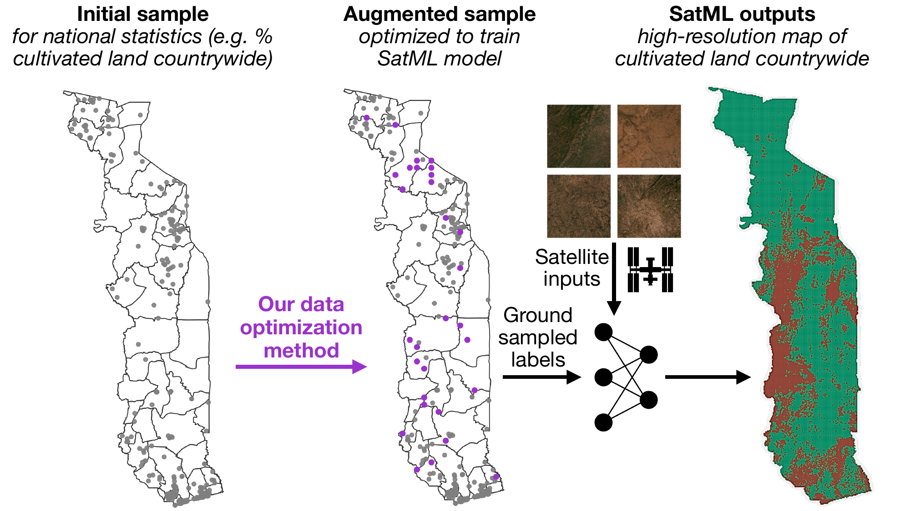

[Mapping on a Budget: Optimizing Spatial Data Collection for ML](https://doi.org/10.1609/aaai.v40i45.41162) was published in the *Proceedings of the AAAI Conference on Artificial Intelligence*. I worked on it with a great team, including collaborators in Togo; the full author list is in the citation below.

## The problem

Satellite imagery covers the whole globe, but the labels used to train models on it usually don't. They tend to be small, spatially clustered, and collected for some other purpose, such as administrative surveys or field plots. Most research responds with new model architectures built to cope with scarce data. That leaves a practical question unanswered: if you have money to collect more data, **where should you collect it?**

## What we did

{fig-alt="Three maps of Togo. Left: grey points showing an initial clustered survey sample. Middle: the same sample with purple points added by the optimization method. Right: a high-resolution map of cultivated land produced by a model trained on satellite imagery and the augmented labels."}

We wrote down the first formal version of this problem. It has two features that real fieldwork always has: collection costs that vary from place to place (some sites are harder to reach than others) and a fixed budget. We then developed new methods for choosing which locations to sample under those constraints.

## What we found

We ran simulations across three continents and four prediction tasks. Optimizing where samples are collected produced substantial gains in model performance. Further experiments showed which settings benefit most from optimized sampling.

## Why it matters

The methods are designed to carry over to any domain that uses satellite machine learning. We paid particular attention to one setting where our coauthors can use the results right away: adding to clustered agricultural surveys in **Togo** so they can support satellite-based monitoring. This links closely to my [maize yield work in Zambia](../2025-11-25-maize-yields-zambia/), where limited ground data is the main bottleneck.

**Citation:** Betti, L., Sanni, F., Sogoyou, G.Z., Agbagla, T., Molitor, C., Carleton, T., Rolf, E. (2026). Mapping on a Budget: Optimizing Spatial Data Collection for ML. *Proceedings of the AAAI Conference on Artificial Intelligence*, 40(45), 38233–38241. [doi:10.1609/aaai.v40i45.41162](https://doi.org/10.1609/aaai.v40i45.41162)
