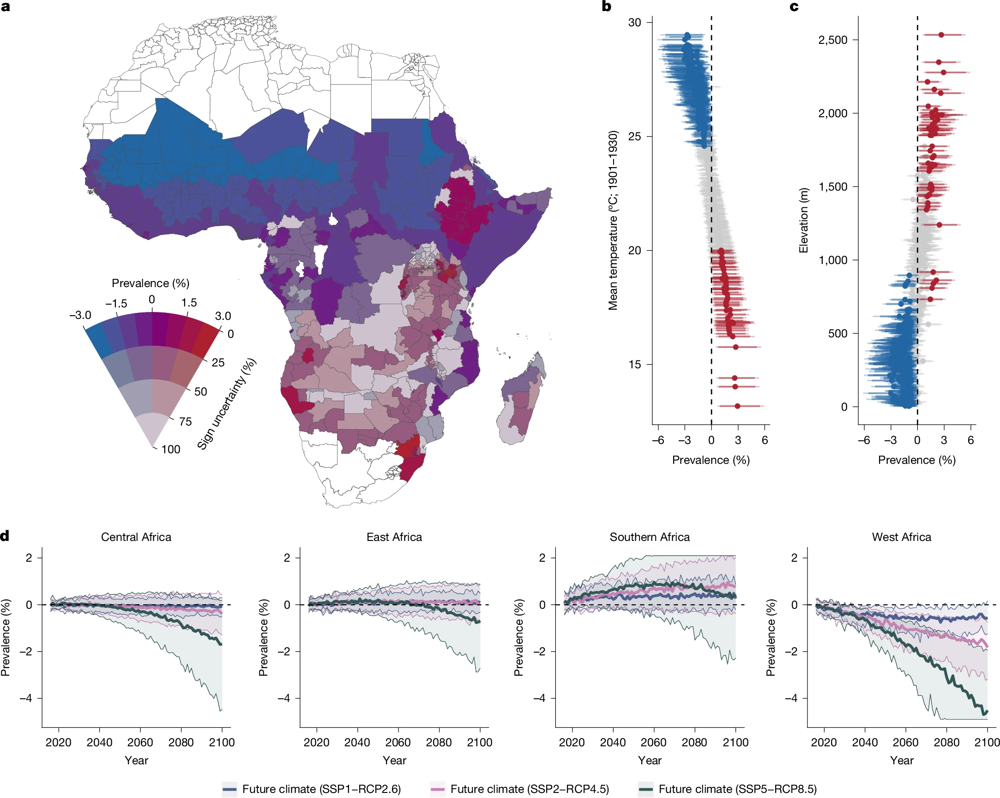

[The past and future impact of climate change on childhood malaria in Africa](https://doi.org/10.1038/s41586-026-10840-w) is out in *Nature*. I'm a co-author with Colin Carlson, Tamma Carleton, Romaric Odoulami, and Christopher Trisos.

## The question

Malaria was one of the first health effects people suspected climate change might cause, and the question has been debated for decades. Despite progress in climate attribution, many health effects of climate change still haven't been measured. We used over a century of clinical data to test whether human-caused warming has actually changed the burden of childhood malaria across sub-Saharan Africa.

## What we found

{fig-alt="Map of Africa colored by change in malaria prevalence attributable to climate change, with decreases in West Africa and increases in parts of East and southern Africa; scatter plots showing increases in cooler, higher-elevation areas and decreases in hotter, lowland areas; and line charts of projected prevalence change to 2100 for central, East, southern, and West Africa under three emissions scenarios."}

- **Temperature and extreme precipitation** have a robust effect on malaria prevalence. This matches earlier local studies and laboratory experiments.
- **The past effect differs by region.** Rising temperatures have probably increased malaria in East and southern Africa but averted a comparable number of cases in West Africa. Across the continent, the net effect is about **1 excess case per 1,000 children** (95% CI −4 to 6).
- **The future could look different from what many expect.** Over the coming century, climate change could slightly speed up malaria elimination in West and central Africa, where the burden is highest today. Across the continent, it could avert 1 (low emissions) to 20 (high emissions) cases per 1,000 children by 2100.
- **Mitigation still matters a great deal locally.** Holding warming under 2 °C instead of 3 °C could prevent an average of about **5 excess cases per 1,000 children** by 2100 in high-elevation East Africa (above 1 km) and in southern Africa.

## Why it matters

The results settle a long-running debate and give a template for measuring the true global health burden of climate change. The effects vary a lot from region to region, and a single continental number can hide large local risks.

The data behind the paper are openly available on [Zenodo](https://doi.org/10.5281/zenodo.20399793).

**Citation:** Carlson, C.J., Carleton, T., Odoulami, R.C., Molitor, C., Trisos, C.H. (2026). The past and future impact of climate change on childhood malaria in Africa. *Nature*, 657(8131), 487–494. [doi:10.1038/s41586-026-10840-w](https://doi.org/10.1038/s41586-026-10840-w)
